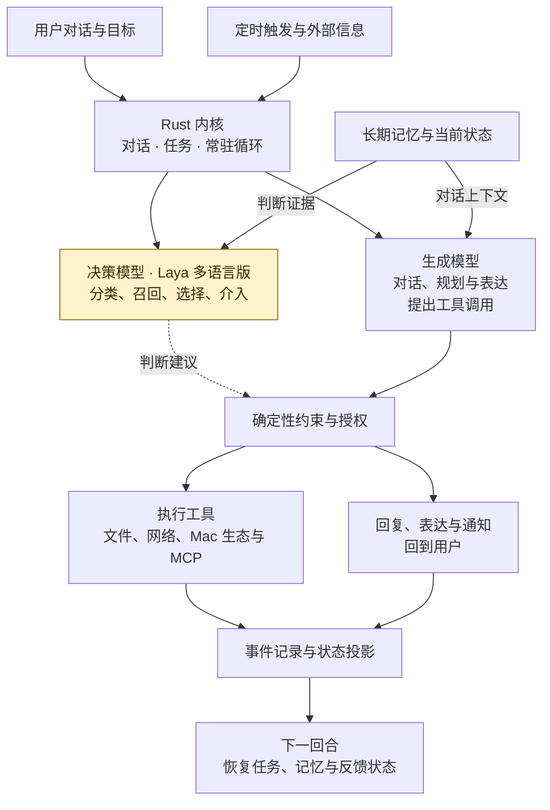
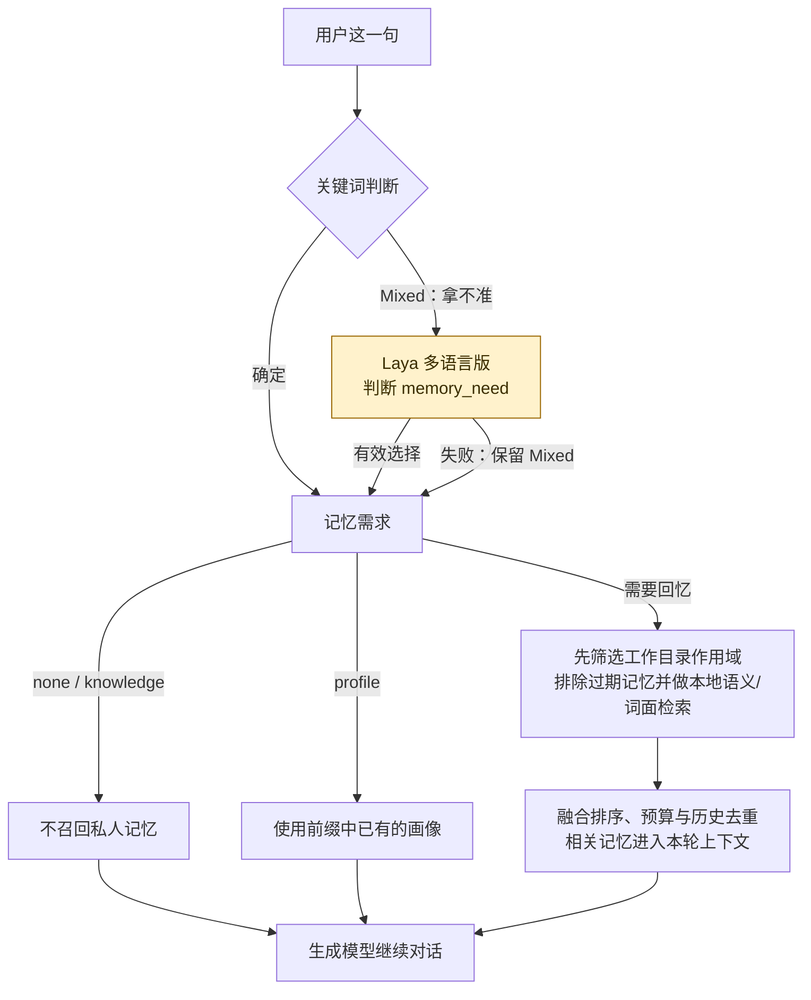
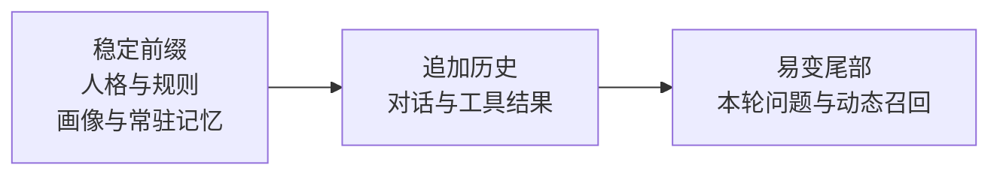
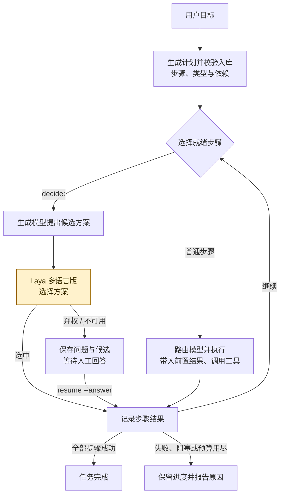
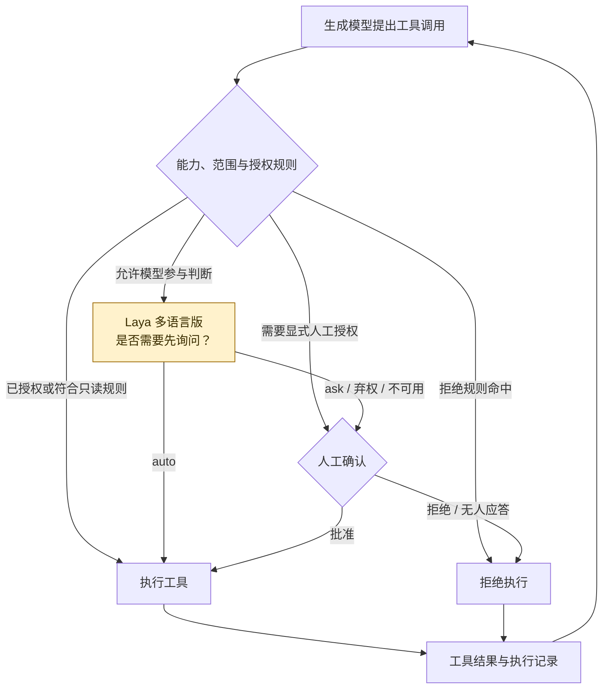
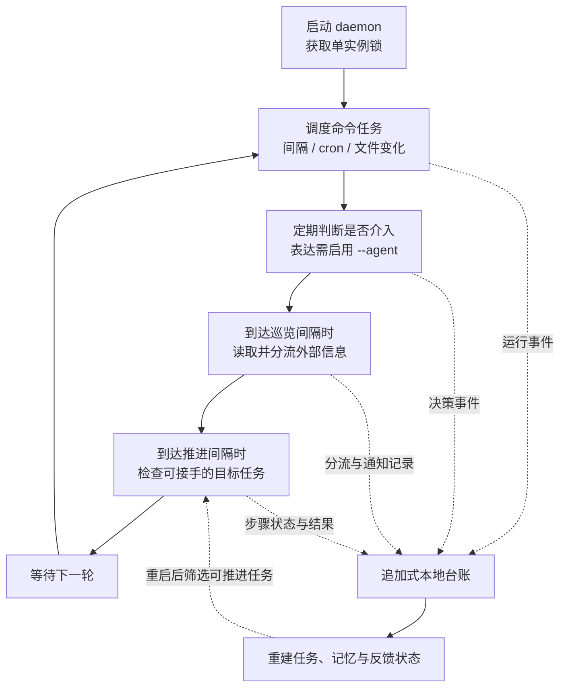

<div align="center">

# YunXi Bot

**陪伴型 · 通用 · 常驻 Agent 助理**

让陪伴有连续性，让行动有分寸。

[当前能做什么](#当前能做什么) · [通用电脑操控](#通用电脑操控) · [邮件与mac联动](#邮件与mac联动) · [系统架构](#系统架构) · [开始使用](#开始使用) · [边界与当前进展](#边界与当前进展)

</div>

YunXi Bot 是 YunXi 家族衍生的个人 Agent。它以本地机器为长期运行的载体，将对你的了解、对当下情境的判断，以及实际执行任务的能力连接起来。你提出需求时，它可以对话、查找信息、操作文件和推进任务；常驻时，它可以关注任务与外部信息，在合适的时候提醒你。

项目的目标是让一个助理长期在场：相处有连续性，行动有边界，主动有分寸。

> **当前状态（2026-10-19）**：重点开发和验收平台为 **Apple Silicon / macOS 14+**，入口是 CLI 与后台守护。聊天和任务由 DeepSeek 生成，本地只需 Laya 决策与按需启动的语义编码器。Windows 通用内核与启动入口保留，新增 Mac 生态工具仅在 Mac 可用；本轮未重做 Windows 真机验收。7×24 常驻是项目目标，长期运行和休眠唤醒尚未完成验收。

## 当前能做什么

Mac 内置注册表共 **61 个工具**，不含用户另接的 MCP 工具。三批能力共用工具审批、执行回执和本地审计，不需要记住工具参数才能在对话中使用。

陪伴现支持[开机关心与近期话题冒泡](docs/开机关心与主动冒泡-20261018.md)：`daemon --startup-care --agent` 在每天首次启动时，由 DeepSeek 结合完整人格、画像、时间工具及 Mac 定位后的真实天气结果生成问候，深夜也沿用这条链路；日常依据近期聊天自然冒泡，普通冒泡夜间静默，无回应逐渐降低频率。系统定位需单独允许，不用 IP 猜地点；生成失败会记录原因，不以固定话术替代，正式记忆与工具写入审批保持。

| 批次 / 能力 | 可以完成的事情 | 当前边界 |
|---|---|---|
| 第一批：通用工具 | 读写和搜索文件、运行命令、网页搜索与抓取、知识库查询、向用户追问 | 写入、命令与外发按策略审批；网页搜索可配置博查，站点限制会明确报错 |
| 第一批：日程与待办 | 从自然语言安排一天；连续追问时间、时长等缺失信息；新增事项后重排；创建、修改、取消日历和待办 | 默认可排 09:00–12:00、13:00–18:00，间隔 10 分钟；写入 iCloud 专用“云熙”日历/列表，保留已有固定安排 |
| 第二批：邮件 | 搜索、完整邮件串、附件保存与文本/PDF读取、标已读、归档；起草、回复、转发、审批发送；收件摘要通知、可选自动拟回复 | 使用 Mac Mail 已同步内容；本机草稿不等于 Mail 草稿邮箱；扫描件 OCR、Office 正文解析尚未接入 |
| 第二批：联系人 | 按姓名、公司、职务或邮箱找人，查看地址，同名时继续确认 | 以已获权限的通讯录为准，不凭称呼猜收件人；真实同名联系人验收仍待补充 |
| 第二批：地点、交通与天气 | 查询地址、路线、驾车/步行/公交预计用时和天气；把准备、通勤绑定到会议 | 营业时间须核实网页；公交当前是预计用时，不含完整换乘方案 |
| 第三批：出行、住宿与多日行程 | 比较公开交通/酒店信息、整理预订资料；统筹多日出行、入住退房、固定约会和弹性工作，写回日历与待办 | **尚无实时票务、酒店库存和预订交易接口**；不支持后台航班延误自动重排 |
| Mac通用电脑操控 | Cua Driver 35项已审核操作：应用与窗口、AX/截图、键鼠、菜单、剪贴板、浏览器、文件选择和下载；可授权连接日常Edge | 操作逐次人工批准；实机覆盖21种操作；基础网页自主填表已通过，跨应用长任务和全应用覆盖仍待验收 |
| 跨任务背景 | 可编辑人格、经确认的画像、长期记忆、会话恢复；任务按阶段刷新背景，检索独立文本知识库 | EmbeddingGemma 2 本地语义编码；资料须显式导入，不自动扫描硬盘，不代表所有入口共用一套召回 |

可以直接这样说，信息不够时 Bot 会追问；示例中的写入和发送仍需相应批准：

- “今天下午三点有个会。”随后补充“一个小时，走路过去，提前十五分钟准备”。
- “今天还要写两小时报告，重新安排一下，别动已经确定的会议。”
- “看看刚才那封人事邮件，把面试和回复截止时间安排好。”
- “根据接下来一周的安排起草回复，把我选的附件带上，先让我确认。”
- “把这份车票和酒店预订整理成两天的行程，检查和已有日程有没有冲突。”

电脑操控使用随项目安装的 **云熙电脑组件（内置Cua Driver 0.36.0）**，需为该组件授予macOS辅助功能与屏幕录制权限；原图和私有界面参数不写入台账或会话。普通MCP仍维持原权限策略。详见[内置组件安装与验收](docs/Cua内置组件-20261018.md)、[电脑操控实机验收](docs/电脑操控实机验收-20261017.md)和[票务酒店预订实测](docs/票务与酒店预订实测-20261017.md)。

已完成三轮核心工具循环的自主填表、点击及结果回读录屏，含不同输入复测；它证明基础控件操控，不代表普通入口、跨应用长任务或真实预订到付款已经通过。范围、失败记录与复现方法见[自主电脑操控录屏验收](docs/自主电脑操控录屏验收-20261017.md)。

真实下单增加`travel_checkout`结算原文核对与`travel_order_read`订单号/状态回读；酒店省略年份时仅可用[真实选择过程的日期证据](docs/酒店结算日期证据衔接方案-20261017.md)，跨标签或来源不明仍拒绝；核对结果仍须经电脑动作的逐次人工审批，待支付不标为已出票或已确认住宿。尚不能把新增工具视为真实订票、订房已经验收通过，范围与限制见[真实下单链路](docs/真实订票与酒店下单链路-20261017.md)。

火车查询提供12306和携程入口，可按用户偏好、登录态和可用性选择；比较票价、服务费及附加服务后的总金额，候补/抢票/代购不等于出票。当前结算核对支持12306火车与携程酒店，携程火车的结算适配及真实下单仍待验收。

经用户授权可连接日常 Edge 的精确窗口，复用已有登录；首次需完成浏览器接入设置，平台登录过期或要求验证码时由用户处理。独立命名配置保留用于指定的测试环境。普通开发不录屏，仅在用户明确要求时录屏验收。详见[Edge接入方案](docs/本机Edge登录复用接入方案-20261017.md)。

Bot已在日常Edge回读两站登录、查询实际车次和酒店列表，并自行进入酒店填写页。本轮包含人工调试指导，尚未通过无指导整单及真实订单到付款页验收。

验收记录：[第一批](docs/第一批工具复验-20261016.md) · [第二批](docs/第二批工具验收-20261016.md) · [第三批](docs/第三批工具验收-20261016.md) · [日程统筹](docs/日程统筹验收-20261016.md)。多日保存会先检查整份计划，但系统写入不是跨日原子事务；中途失败会报告已完成部分。

## 通用电脑操控

电脑操控是正常工具注册表中的通用能力，`chat`、`do`、任务恢复和后台共用；后台没有真人审批入口时不能执行界面动作。它不限定于订票、订酒店：`computer_schema`提供已审核的操作结构，`computer_observe`读取指定窗口的界面与截图，`computer_act`执行一个经批准的动作，随后重新观察实际结果。`computer_verify`只读核对最新实际观察中的文字、URL和控件状态，仍需真实文件或业务回执证明任务完成。出行的`travel_prepare`、`travel_checkout`和`travel_order_read`另行负责业务条件与结算核对。

执行底座来自 **[Cua Driver / trycua/cua](https://github.com/trycua/cua/tree/6d6c734c127025fb39ad5d585a10382808b39dc1/libs/cua-driver)**，固定版本 **0.36.0**，Copyright © 2025 Cua AI, Inc.，Driver主体采用MIT许可。云熙提供模型工具循环、图片传输、审批、观察有效期、并发锁和私有结果处理。上游Driver子项目的完整源码快照已随仓库提供，见[源码与来源说明](third_party/cua/README.yunxi.md)、[版本记录](third_party/cua/UPSTREAM.json)、[原始许可证](third_party/cua/LICENSE.md)及[第三方声明](third_party/cua/libs/cua-driver/rust/THIRD_PARTY_NOTICES.md)。上游可选组件与素材各自的许可声明一并保留，不将整个Cua仓库统称为MIT。

通用循环进一步参考了 [browser-use](https://github.com/browser-use/browser-use)、[agent-browser](https://github.com/vercel-labs/agent-browser)、[UI-TARS](https://github.com/bytedance/UI-TARS-desktop) 与 [Travel Agent](https://github.com/Prism-Shadow/travel-agent)：旧界面正文和截图一同退役，同批共享界面只派发一次，人工接管后重新观察，内容持续不变时提示重新规划。没有引入这些项目的整套运行时；版本、源码落点和许可见[补强记录](docs/通用电脑操控补强-20261018.md)及[NOTICE](NOTICE)。

模块整合还参考了 [Peekaboo](https://github.com/openclaw/Peekaboo) 的原生Sheet结构定位和 [Playwright](https://github.com/microsoft/playwright) 的控件、弹窗专用处理：驱动、观察租约、原生弹窗和任务核验分别维护；文件选择器从真实父窗口读取控件，拒绝活动弹窗下的背景点击；多义选择通过`ask_user`正式挂起，明确只查看时可核验保留。未引入额外运行时或自动关闭行为，固定版本、实际失败与复测见[整合记录](docs/电脑操控模块整合与重构-20261018.md)。

Mac安装脚本会构建`target/macos/云熙电脑组件.app`，内含固定版本Driver和许可声明；运行时不再依赖`/Applications/CuaDriver.app`。首次使用运行`bash scripts/computer-component.sh authorize`并在系统设置允许两项权限。电脑工具按需启动宿主，驱动作为宿主的直接子进程运行；原生邮件/日历助手保持独立。安装优先复用本机通过官方签名与版本校验的Driver，否则下载固定SHA256安装包；不安装可选感知模型。使用日常Edge需用户明确授权后运行`bash scripts/computer-component.sh allow-existing-profile`，浏览器自身的远程调试确认仍需完成。详见[安装与边界](docs/Cua内置组件-20261018.md)。

已有实测包括大模型自主填写临时网页、把实际结果写入临时TextEdit文档并保存核验，以及计算器控件点击和截图读取；跨应用成功样本与失败迭代见[补强记录](docs/通用电脑操控补强-20261018.md)。弹窗遵循先读内容、重要信息保留、含义不清正式追问的规则；专项覆盖网页弹窗、原生Sheet、文件选择器、敏感授权和未保存场景，修补与最新结果见[整合验收](docs/电脑操控模块整合与重构-20261018.md)，[早期失败记录](docs/电脑弹窗处理验收-20261018.md)保留供比较。通用动作仍逐次人工审批，不开放任意脚本、安装更新或录屏管理接口；临时出行测试中的有限自动批准不进入生产。**长任务稳定性、任意网站可靠操作及真实预订到付款页的完整自主流程尚未通过验收**。当前补强已部署到本机常驻发布版；Cua已内置，安装及实测范围见[组件验收](docs/Cua内置组件-20261018.md)。

助理基础能力的源码筛选、Codex安装包静态研究和独立接入计划见[能力与源码清单](docs/Codex底层能力调查与源码接入清单-20261018.md)。公开源码按固定版本保存在本机开发资料目录，未作为运行依赖加入。首项已补齐MCP工具目录分页：后页工具可完整发现，游标循环、目录超限、中途失败及重名明确拒绝；工具仍走原有审批与审计。

进一步的[电脑操控全链路研究](docs/Codex电脑操控全链路与云熙接入-20261018.md)追到浏览器RPC/CDP和Mac IPC/AX执行路径，并用受控操作与原生采样交叉验证。研究同时保留浏览器弹窗超时的失败证据；这不是完整私有源码恢复，也不代表云熙已完成相同能力接入。

已据此独立接入同一窗口/标签的只读条件等待、固定失败诊断，并修正DeepSeek工具循环的上下文回传。实际调用和业务完成仍分别核验；接入范围、真实跨应用测试与剩余限制见[接入验证](docs/电脑操控接入补强与真实验证-20261018.md)。

## 专用浏览器与网页流程复用

网页任务默认可启动云熙自己的Chromium实例与持久配置，复用已安装的Chrome/Edge内核；日常Edge和旧旅行配置仍可显式使用。模型首次执行导航、语义点击和填表后，可核验并保存参数化候选；再次使用由本地执行器经CDP逐步回放，不必每一步都调用大模型。

新增`browser_workflow`（查找/学习）、`browser_workflow_save`（核验保存）和`browser_workflow_run`（回放）。不保存输入原文、Cookie、截图、旧引用或坐标；回放每步重新观察、唯一定位、逐次审批和留痕。页面变化、重复匹配、弹窗或失败时停止，交还模型/用户。订单、发信等业务成功仍须独立回读。

已通过本机合成网页的学习→换参数回放，以及DeepSeek自主学习与复用验收；回放内部模型调用为0。当前支持完整语义观察中的单标签导航/点击/替换输入，复杂分页与跨标签仍走普通电脑操控。命名配置正常退出后保留状态；上游强制结束会话可能丢失刚写未落盘的数据，不能保证永久登录。来源、实现和真实边界见[专用浏览器与网页流程库](docs/专用浏览器与网页流程库-20261018.md)。

## 邮件与Mac联动

**接收侧**：本地发现新信与去重 → DeepSeek 用独立的[接收提示词](crates/yunxi-bot-core/src/prompts/mail_review.md)只读提炼内容、行动项、期限和风险 → Laya 留下参考判断 → 确定性策略 → Mac 通知或待查看。分析不带工具权限，邮件中的要求不会直接触发发信、改日程或执行附件。

- 通知采用“**云熙 · 邮件｜人事回复**”等来源与关键词标题，附发件信息、摘要、待处理事项和原邮件时间。
- 开启 DeepSeek 审理的 Mac 邮件已取消共用的每日 3 次上限和 120 分钟间隔。有效建议需要及时提醒的邮件及时处理，同轮多封合并；无行动项、期限或风险的普通工作/私人/交易信息进入 **15 分钟摘要窗口**。
- 23:00–08:00 安静时段、明确静默、黑名单、通知去重、调用预算及系统专注模式仍生效。未知、不完整或分析失败留待查看；投递失败保留批次并退避核对，不当作已读。
- 用户随后可说“处理刚才那封邮件”，读取原文并关联日历、待办；单纯接收邮件不会自动创建或完成这些事项。

**发送侧**：核对联系人与邮箱 → 读取用户指定的资料和近期安排 → 用独立的[发送提示词](crates/yunxi-bot-core/src/prompts/mail_send.md)起草 → 展示收件人、正文、附件与当前版本 → **逐封确认发送** → 查询本机提交/发件记录。可跨会话找回草稿、替换附件，再按用户要求创建跟进待办或日程；发件端回执不能代替收件人确认收到。

可选的**自动拟回复**只处理开启后的新邮件：结合真实邮件串、未来 7 天忙闲与待办期限、可用画像，生成可审核正文或待确认问题。日历标题和备注不提供给拟稿模型；有空档也不代表已同意预约。不会无人值守发送，缺少信息时可能只返回问题。

```bash
./启动.command mail --pending                    # 待查看邮件
./启动.command mail --pending --include-notified # 包含已通知邮件
./启动.command mail --reply-mode review          # 开启新邮件自动拟回复
./启动.command mail --replies                    # 查看建议及待确认问题
./启动.command mail --reply-mode off             # 停止自动拟回复，保留已有建议
```

使用前先按下文配置 Mail 来源和内容审理。后台巡检是在本地运行的循环，不是每次轮询都调用大模型；仅需分析、拟稿等工作才产生云端请求，已有有效分析会复用。发现延迟还受 Mail 同步、串行模型调用和休眠影响，不能保证每封邮件固定秒数内通知。

详情：[收件理解](docs/邮件理解通知验收-20261016.md) · [通知分流](docs/通知与主动陪伴分流方案-20261016.md) · [邮件与日历待办](docs/邮件与Mac联动-20261016.md) · [发送侧](docs/邮件发送与Mac联动-20261016.md) · [自动拟回复](docs/邮件代回复与双向提示词-20261016.md)。

## 设计哲学

### 陪伴的温度来自连续性

人格决定表达方式，记忆承接共同经历，画像保存经确认的用户信息。一次关心应当有具体依据：你说过什么、正在做什么、之前发生过什么。连续的状态让下一次互动可以接着上一次发生。

### 主动性需要判断，也需要克制

一个常驻助理会遇到大量事件，而用户的注意力是有限的。YunXi Bot 将“是否需要召回记忆”“是否需要询问”“此刻是否值得打扰”等判断交给本地决策模型参与，再以确定性约束限制行动。安静时段、打扰频率和授权边界不会因模型的建议而被放宽。

### 通用能力围绕目标组织

用户可以给出一个目标，由系统拆解、传递前置结果、调用工具并保存进度。文件、命令和网络是通用能力，MCP 提供扩展入口。任务内核负责目标与状态，具体动作交给工具执行。

### 常驻意味着持续负责

任务进度、记忆、决策和反馈落在本地。守护循环检查触发条件、推进可继续的任务、巡览信息；遇到需要人工判断的情形，保存现场并交还给用户。持久化、恢复、超时和失败处理共同支撑这种连续性。

这些取舍继承了 YunXi 家族的陪伴与治理设计。Bot 的主要探索集中在**跨模块的决策能力、内聚的任务内核和常驻形态**；代码独立，不依赖其他 YunXi 仓库才能编译。设计依据见 [ADR-0001](docs/adr/0001-架构与边界.md)，来源见 [NOTICE](NOTICE)。

## 系统架构

系统有两类互补的模型能力：**决策模型**回答有明确选项的问题，**生成模型**负责理解目标、组织内容和提出工具调用。Rust 内核组织流程、执行规则并记录状态。

下面先展示核心协作关系。决策模型贯穿业务模块；具体调用位置与触发条件，在后续各图中展开。虚线表示模型建议，不代表直接执行。



### 决策能力嵌入在哪里

Laya 多语言版是共享的本地判断能力。各模块构造自己的问题与证据，解释答案，再应用对应的约束和失败处理。图中的黄色节点均表示 Laya 的业务判断。

| 参与模块 | 判断的问题 | 对运行的影响 |
|---|---|---|
| 输入分类 | 这句话是在办事，还是在闲聊？ | 建议回复模式；工具调用由 DeepSeek 结合连续对话提出，执行仍受审批约束 |
| 记忆召回 | 回答这一句，需要关于用户的什么记忆？ | 决定是否进入动态召回；关键词不确定时调用 |
| 工具门禁 | 这个动作是否需要先询问用户？ | 在规则允许进入模型判断的路径上，选择自动执行或询问 |
| 任务决策点 | 根据现有证据，应选择哪个候选方案？ | 为 `decide:` 步骤选择结果，弃权则等待人工 |
| 陪伴介入 | 现在适合开口、延后，还是沉默？ | 结合记忆和现状决定介入，再受安静时段等约束收紧 |
| 通知分流 | 这条外部信息值得现在提醒吗？ | Mac 内容审理采用 DeepSeek 建议、Laya 参考；未启用审理的旧路径仍由规则/Laya 分流 |

输入分类、召回、审批、任务决策、陪伴和通知具有不同的失败代价。模型不可用时，审批与任务决策倾向交给人，陪伴与通知倾向不打扰；召回门控保留保守的召回判断。输入分类失败会停止当前回合并记录降级原因。模型答案不构成越过权限的依据，未校准的概率也不用于强制审批阈值。

实现入口：[决策契约](crates/yunxi-bot-core/src/decide/mod.rs) · [对话装配](crates/yunxi-bot-cli/src/chat_handler.rs) · [任务决策](crates/yunxi-bot-core/src/task/decide.rs) · [陪伴约束](crates/yunxi-bot-core/src/companion.rs)

### 运行组件与模型分工

| 组件 | 当前实现 | 职责 |
|---|---|---|
| 主程序 | Rust 2024，CLI + core 两个 crate | 会话、任务、调度、约束、工具和台账 |
| 决策服务 | Laya 多语言版，回环端口 `17870` | 结构化分类与选择 |
| 生成服务 | `deepseek-flash` | 闲聊、任务、摘要、画像提炼、主动陪伴表达；默认不加载本地生成权重 |
| 语义检索服务 | EmbeddingGemma 2 文本编码器，CPU，回环端口 `17873` | 目标任务的向量记忆与知识检索；按需启动 |
| 邮件巡检 | Mac默认原生Mail；其他平台或显式选择时使用IMAP sidecar `17871` | Mac配置启用DeepSeek只读理解后，由其建议提醒、Laya作参考，再经固定策略通知；不标记为已读 |
| Mac助理接口 | 原生应用，EventKit / Contacts / MapKit / Mail | 日程、待办、联系人和邮件等工具；云熙本机草稿，经审批后交由Mail发送 |
| MCP | Rust 客户端 + stdio 子进程 | 连接外部工具；异步运行时封装在 MCP 模块内 |

<details>
<summary>展开输入分类与模型分工</summary>

每条聊天输入先由 Laya 建议回复模式。闲聊与任务均由 DeepSeek 处理，连续追问中的短答不会撤掉工具；实际调用通过既有工具审批和执行链路。缺信息直接追问，下一条回答可以沿用已保存的会话背景。
分类不可用、弃权、返回未知选项或审计失败时停止本轮，不伪装成正常闲聊。模型分类尚未校准，不能替代审批。

`do`、`resume` 和 daemon 的目标任务都使用 DeepSeek；`--provider local` 不再用于助理任务。
`--thinking auto` 下聊天不开思考，规划和分析开启；显式 `on/off` 仍生效。
摘要、画像候选和主动陪伴表达也使用 DeepSeek。Laya 与向量编码器留在本机，Gemma/Qwen 权重仅留作实验，不自动启动。

**生成需要联网和 DeepSeek 凭证。** 人格、画像、召回片段与必要的工具结果会进入相应请求；源资料和向量库仍存放在本地。
远端故障明确报错，不自动加载本地生成模型。使用与验收见 [轻量运行架构](docs/轻量运行架构.md)。

源码：[router](crates/yunxi-bot-core/src/think/router.rs) · [local_health](crates/yunxi-bot-core/src/think/local_health.rs) · [OpenAI 兼容客户端](crates/yunxi-bot-core/src/think/client.rs)

</details>

## 图片输入

现有 `deepseek-flash` 接入支持文字与图片一起发送，适用于图片问答、截图文字和图表理解，流式聊天可继续追问。图片会发送给 DeepSeek；聊天支持显式附图，电脑操控的观察工具也会传递受控截图。

```bash
# 单次看图；多张图片重复 --image
cargo run -- think '这张图里有什么？' --image '/完整路径/图片.png'

# 连续对话：进入 chat 后，先附图，再输入问题
cargo run -- chat
/image /完整路径/图片.png
这张图里有什么？
```

支持 PNG、JPEG、GIF、WebP，按实际文件签名检查；单张最多 8 MiB，图片上下文最多 8 张、合计 16 MiB。`/image clear` 清空尚未发送的附图。图片编码不写进日志或会话存档；恢复会话时需要重新附图，模型的文字回答仍按原有规则保存。图片内容不构成执行动作的授权。

Cua电脑操控的截图已接入工具循环；普通MCP图片转交及邮件附件自动看图尚未接通。使用范围与验收见[图片传输](docs/图片传输-20261017.md)和[电脑操控实机验收](docs/电脑操控实机验收-20261017.md)。

## 记忆与人格

相处的连续性由几种不同的状态共同承担。

| 状态 | 保存什么 | 如何使用 |
|---|---|---|
| 人格 `persona.md` | 名称、语气与相处方式 | 参与稳定系统提示词的组装 |
| 画像 `profile.md` | 经用户确认的身份、偏好与背景 | 进入稳定前缀；模型提议先进入待确认列表 |
| 长期记忆 | 事实、偏好、关系、事件、工作目录记忆 | 从台账投影，按需要召回；工作目录记忆受当前目录限制 |
| 陪伴跟进 | 经确认的话题、时间与关联日历/待办 | 到期重查真实状态，经静默/退避规则后发送原生通知 |
| 会话历史 | 当前对话及工具交互 | 每轮保存，可恢复；长上下文可压缩 |

人格和画像的容量上限均为 **32 KiB**；超限会明确报错，不自动删改原文。个人灵魂文件、画像、聊天台账、凭证及原始验收资料只留在本地数据目录，不随仓库发布。完整加载与单轮取用已验证，但持续的人格表现、自然度和陪伴体验仍待下一轮评估，不把“文件读入成功”视为体验已经完善。

### 先判断需要，再召回内容

对话会先识别记忆需求。常见问法由关键词处理，拿不准时让 Laya 区分私人记忆、用户画像、通用知识等需求。随后由检索代码完成召回和筛选。



**记忆也反过来支撑决策。** `Memory::build_decision_state` 从事实、偏好、关系与事件中取出有限证据，与互动间隔、待处理事件等现状组合，供陪伴判断使用。于是，“记得什么”和“何时介入”形成连接。

图中的“需要回忆”包括 `episode / long_term / mixed`，当前进入同一条检索链。`knowledge` 只表示不翻私人记忆，不会自动启动知识库搜索。聊天已加入现有本地语义编码器；服务不可用时明确记为降级，回退到字符 n-gram 与词面匹配。

上图描述 `chat` 的私人记忆召回。`do`、`resume` 与 daemon 的目标任务已按阶段刷新人格、画像、常驻记忆及项目规则，并通过 EmbeddingGemma 2 分别检索向量记忆和独立知识库；前置步骤结果另外保留。知识库支持显式导入 UTF-8 Markdown/文本、查询、移除和重建，见[任务上下文与知识库](docs/任务上下文与知识库.md)。主动陪伴与聊天共享可编辑人格、画像和正式记忆，另附范围明确的跟进资料。

### 记忆如何进入系统

`remember` 显式记录一条记忆；`profile --learn` 从最近会话的用户发言中提炼画像候选，再由 `--accept` / `--reject` 确认。后者使用 DeepSeek。开启陪伴后台后，会从近期真实用户原话整理有逐字证据的记忆候选，确认后才进入正式记忆。临时心情有有效期，纠正/忘记会停用旧召回与跟进；下一轮会重建可见上下文，审计历史仍保留。

```powershell
cargo run -- remember "回答时先给结论，再展开解释" --kind preference
cargo run -- remember "这个项目使用 cargo test 验证" --kind workspace
cargo run -- memory
cargo run -- profile --learn
cargo run -- profile --pending
cargo run -- memory --pending
cargo run -- memory --accept <候选ID>
cargo run -- memory --reject <候选ID>
cargo run -- memory --followups
```

<details>
<summary>展开上下文组装、缓存与会话恢复</summary>



稳定内容带指纹，动态召回放在尾部，词面召回对已注入历史的记忆去重，语义召回按本轮相关性与预算截取。超过上下文预算时，系统压缩较早的历史，并保留工具调用与结果的配对。提示词的稳定结构为模型前缀缓存提供条件，实际命中由模型服务决定。

```powershell
cargo run -- chat list
cargo run -- chat --resume
cargo run -- chat --resume --id '实际会话ID'
```

源码：[记忆投影与召回](crates/yunxi-bot-core/src/memory.rs) · [召回问题](crates/yunxi-bot-core/src/recall_gate.rs) · [提示词组装](crates/yunxi-bot-core/src/think/prompt.rs) · [上下文压缩](crates/yunxi-bot-core/src/think/context.rs) · [会话存储](crates/yunxi-bot-core/src/think/session.rs)

</details>

## 任务执行

`chat` 适合在交互中边聊边做，模型可以直接进入工具循环。`do` 接受目标，建立带步骤与依赖的持久化任务；`resume` 接着推进已有任务。对话中的办事请求不会自动等同于创建一个 `do` 任务。



任务引擎负责状态迁移、依赖、重试与人工介入。每次推进重新读取任务投影，将前置产物交给后续步骤。当前步骤按顺序执行；全部步骤进入终态不等于目标达成，存在失败或跳过时不会一律报告完成。

```powershell
cargo run -- do "阅读当前目录的项目文档，整理一份模块说明保存到 overview.md"
cargo run -- tasks
cargo run -- tasks '实际任务ID'
cargo run -- resume '实际任务ID'
cargo run -- resume '实际任务ID' --answer "采用第二个方案"
```

默认最多拆解 12 步，单步最多尝试 2 次，工具循环默认最多 8 轮并检测重复调用。`--budget` 控制一次引擎推进的调用计数，默认 20，**不等同于跨恢复累计的费用上限，也不逐次限制工具循环内的所有模型请求**。实际调用用量另外写入成本台账。

源码：[任务状态](crates/yunxi-bot-core/src/task/model.rs) · [计划解析](crates/yunxi-bot-core/src/task/plan.rs) · [执行引擎](crates/yunxi-bot-core/src/task/engine.rs)

### 工具与权限协同

内置工具覆盖[三批能力](#当前能做什么)及知识检索。DeepSeek 根据连续对话提出调用，Laya 的闲聊标签不会撤掉工具。门禁先检查规则；需要判断的路径再询问 Laya，无法确定则交给人。

<details>
<summary>展开工具审批、执行与结果回灌</summary>



`ReadOnly / Write / Execute / Network / Outbound / Unknown` 区分动作的能力与风险。网络访问独立于只读文件操作；不可逆动作及能力未知的工具不交给模型判断。拒绝规则优先，明确的用户预批准按范围匹配。

文件覆盖要求先读取，写入审批可以展示 diff。命令执行带超时、环境变量筛选和进程清理。不同工具具有不同的执行与隔离机制，不能把一处门禁等同于整个进程拥有完整沙箱。

```powershell
cargo run -- tools
cargo run -- do "读取 README.md 并说明项目定位" --allow read_file
cargo run -- mcp list
```

MCP 使用 stdio 传输，从数据目录中的 `mcp.json` 加载配置。当前 `chat` 接入 MCP 工具；`do`、`resume` 和守护任务推进尚未装配同一套 MCP 扩展。默认 MCP 工具按能力未知处理；配置中的 `require_approval` 会影响能力分类。独立的 `mcp call` 命令直接调用工具，不经过上述对话工具门禁。

源码：[工具注册与门禁](crates/yunxi-bot-core/src/tool/mod.rs) · [工具循环](crates/yunxi-bot-core/src/tool/runner.rs) · [MCP](crates/yunxi-bot-core/src/mcp.rs)

</details>

## 主动陪伴

新后台已具备有来源的跟进能力，通过`daemon --agent`启用。可以在聊天中说“面试结束后问问我的感受”，由Bot明确时间、关联实际日历/待办并提出确认；之后后台自动核对状态、组织表达并发出“云熙 · 陪伴｜后续关心”通知。跟进可以改期、取消或标记已回应；用户回来聊天时可接上实际已投递的话题。

流程是：**确认的跟进 → 时间/有效期/静默与退避 → 读取关联事项当前状态 → Laya参考留痕 → DeepSeek无工具表达 → 再核对状态 → Mac通知回执**。真实测试发现Laya会把已约好的关心判为Quiet，因此用户批准由确定性规则执行已确认跟进；模型不替代授权或策略。

默认23:00–08:00安静，至少间隔60分钟，无回应逐渐退避至2/4/8小时。陪伴没有每日3次通知上限，与重要邮件分开；整理和表达共用独立的48次/24小时调用预算。模型计算在单个后台线程进行，邮件主循环继续运行。没有明确话题时不生成泛泛的定时寒暄，后续主观陪伴体验仍需日常使用验证。

聊天中可以复用现有邮件、天气、日程等工具提供具体帮助，所有写入和外发继续使用原审批。后台跟进取材目前限定关联日历、待办，不自行读取所有邮件、屏幕或私人文件。

实现、开源取舍、数据升级和验收：[陪伴与记忆](docs/陪伴记忆实施与验收-20261018.md)。旧v1台账须在停止所有写入者、备份后执行`memory --upgrade`；旧程序不能直接读取新v2数据。

设计上区分“决定提醒”“尝试投递”“已确认送达”和“用户已读”。已审理 Mac 邮件在调用系统前保存固定批次，失败或结果未知时退避核对，取得确认回执后逐封记账；普通摘要不额外调用生成模型。旧通知路径保留既有去重语义。Mac 回读到通知中心记录才确认送达，仍不能证明横幅可见或用户已读，也不能保证极端崩溃情况下绝无重复。

```powershell
cargo run -- check --dry-run
cargo run -- feedback --last --read
cargo run -- feedback --last --never
cargo run -- journal
```

`check --dry-run` 仍会读取信息、执行判断并写台账，只是不发送通知。Mac使用 [本机Mail巡检](docs/邮件原生通知验收-20261016.md)；其他平台或显式指定 `--mail-source imap` 时，配置并启动 [邮件 sidecar](sidecar/mail_server.py)。

源码：[陪伴回合](crates/yunxi-bot-core/src/agent.rs) · [信息巡览](crates/yunxi-bot-core/src/assistant.rs) · [通知分流](crates/yunxi-bot-core/src/triage.rs) · [反馈投影](crates/yunxi-bot-core/src/feedback.rs)

本轮全工具验收覆盖58项注册工具，其中53项取得真实成功执行证据；其余包含发送和订单等受审批或账号条件限制的路径，不能当作全部真实业务成功。模型曾出现调用顺序和保存意图偏差，修正与未覆盖范围见[全工具稳定性验收](docs/全工具稳定性与模型选择验收-20261018.md)。

## 常驻与可追溯性

守护进程把周期性调度、信息巡览和任务推进放进同一个运行循环。命令任务 `job` 保存“何时执行什么命令”；目标任务 `task` 保存“如何逐步完成目标”。两者共享台账，但拥有各自的状态与调度逻辑。

<details>
<summary>展开守护循环与持久化协作</summary>



| 节奏 | 当前默认值 | 调整方式 |
|---|---|---|
| 主循环 | 5 秒 | `--interval`，单位毫秒 |
| 邮件巡览 | 300 秒 | `--assistant-interval`，`0` 关闭 |
| 目标任务推进 | 60 秒检查一次，闲置 120 秒后可接手 | `--task-interval` / `--task-idle`，单位秒 |
| 陪伴表达 | 用 `--agent` 启用；每60秒检查 | `--judge-every 0` 可关闭；正数兼容启用 |

陪伴与邮件复用决策引擎，但未显式启用`--agent`时不会进行陪伴整理或表达。需要纯命令调度时，可显式关闭邮件巡览和目标任务推进。

上表是 CLI 默认值。当前 Mac 部署保留15秒邮件巡检、关闭任务自动推进，并已启用`--agent`；生产台账已备份并升级v2。轮询本身不会固定调用生成模型。普通邮件摘要窗口仍是 15 分钟。

`supervise` 在守护异常退出后重启，Windows 登录自启使用当前用户的启动目录。macOS 则由用户级 launchd LaunchAgent 直接管理 daemon，并保留注册时指定的启动参数。当前 `supervise` 只转发主循环间隔，不会转发全部 `daemon` 参数。无人值守的审批者不授予新的人工作业批准；需要人工的任务应回到交互入口处理。

```powershell
# 仅运行命令任务调度
cargo run -- daemon --assistant-interval 0 --task-interval 0

# 启用陪伴表达；保留默认巡览和任务推进
cargo run -- daemon --agent

# 监督与 Windows 当前用户登录自启
cargo run -- supervise
cargo run -- install-autostart
cargo run -- uninstall-autostart
```

</details>

台账采用追加式 JSONL，任务、记忆、反馈等状态由事件投影得到。模型调用、工具结果与决策记录让运行过程可以回查；会话历史另外保存在 `sessions/`。重启后可重新读取状态，但不能据此保证外部动作恰好执行一次。

```powershell
cargo run -- status
cargo run -- log -n 20
cargo run -- journal
cargo run -- cost --calls 10
```

运行数据由 `YUNXI_BOT_HOME` 指定；未设置时，Windows 使用 `%LOCALAPPDATA%\YunXiBot`，其他平台使用 `~/.yunxi-bot`。仓库的便携启动脚本另行将其指向仓库内的 `data/`。台账、会话、权重与凭证不应提交到 Git。

## 开始使用

当前从源码安装。GitHub 的 `models-v1` 是历史 Verdict 权重归档，**不是当前 Mac 应用安装包或 Laya 权重包**；当前下载器以仓库模型清单为准。首次安装需要联网，默认不下载大型聊天模型。

### macOS（当前主要验收平台）

需要 Apple Silicon、macOS 14+、Xcode Command Line Tools、Git、Rust 1.88+ 和 Python 3.12。先准备这些工具，再执行：

```bash
git clone https://github.com/sjxbbdb/YunXi-Bot.git
cd YunXi-Bot
export YUNXI_BOT_HOME="$PWD/data"
./安装Mac环境.command
./启动.command mac status
```

安装脚本创建 `.venv`、准备 Laya、构建 Rust release 和“云熙本机助理”原生应用。默认数据目录为仓库 `data/`；自定义目录须在安装、交互与后台使用同一个 `YUNXI_BOT_HOME`。

在本机设置 `YUNXI_BOT_DEEPSEEK_KEY`，或把密钥单独保存到 `$YUNXI_BOT_HOME/secrets/deepseek.key`，文件权限设为 `0600`。后台使用凭证文件更方便；不要把密钥写进脚本、JSON 配置、Git 或命令示例。日历和待办写入需要可用的 iCloud 账户；邮件须先在 Mac Mail 登录并完成同步。

```bash
# 按使用需求申请；必须在 macOS 系统提示中允许
./启动.command mac authorize calendar
./启动.command mac authorize reminders
./启动.command mac authorize contacts
./启动.command mac authorize mail
./启动.command mac authorize notifications
./启动.command mac authorize location

# 开始交互
./启动.command chat
./启动.command do "读取 README 并总结项目用途"
```

**知识库按需安装**：首次使用前准备语义模型；导入的源文件不会自动刷新。

```bash
.venv/bin/python scripts/fetch_embedding_candidates.py --only embeddinggemma-2
./启动.command knowledge add /完整路径/资料.md
./启动.command knowledge search "需要查询的内容"
```

**邮件后台是单独配置的可选能力**：先通过 `mac_mail_accounts` 查询真实账户 ID，在数据目录建立 `mac-mail.json`，仅列希望巡检的邮箱，例如：

```json
[{"account_id":"替换为真实账户ID","mailbox_path":["INBOX"]}]
```

若同意把这些邮箱的新邮件主题、发件信息与正文发给 DeepSeek 只读分析，再建立 `mail-analysis.json`，内容为 `{"provider":"deepseek"}`。首次开启建立历史基线，不集中通知旧信；自动拟回复须另外开启，画像和线程会参与相应云端请求。

```bash
# 前台巡检；15 秒是检查间隔，不是送达时限
./启动.command daemon --mail-source mac --assistant-interval 15 --task-interval 0 --judge-every 0

# 或退出前台守护后，注册登录自启
./启动.command install-autostart -- --mail-source mac --assistant-interval 15 --task-interval 0 --judge-every 0
./启动.command autostart-status
# 停止并取消自启，保留数据
./启动.command uninstall-autostart
```

系统权限和 Bot 动作批准分别生效。原生应用使用本机签名，重建后 macOS 可能要求重新授权；更换电脑或移动目录不能直接复用权限和自启路径。详细配置见 [Mac 开发指南](docs/macOS开发.md)与[本机工具](docs/Mac本机助理工具.md)。

### Windows 通用内核

以下命令以 PowerShell 7.1+ 为例，需要 Git、Rust 1.88+、编译工具和 Python 3.12。Mac 原生工具不随这些命令获得 Windows 实现。

#### 1. 构建并准备决策模型

```powershell
git clone https://github.com/sjxbbdb/YunXi-Bot.git
cd YunXi-Bot

# 让本节各终端使用同一数据目录；新终端也需设置此变量
$env:YUNXI_BOT_HOME = Join-Path $PWD 'data'

pwsh scripts/setup.ps1
cargo build
cargo run -- isolation-check
```

`setup.ps1` 创建 `.venv`、安装 Laya 0.4.7，并下载 Laya 多语言权重（约 678 MB）。使用固定 Hugging Face revision，校验权重、词表与编码器配置 SHA256。清单位于 [models/manifest.json](models/manifest.json)。这个步骤**不会下载本地 Qwen 模型，也不保证安装了适配显卡的 CUDA 版 PyTorch**。

在一个单独终端中，从仓库根目录启动决策服务：

```powershell
$env:YUNXI_BOT_HOME = Join-Path $PWD 'data'
.\.venv\Scripts\python.exe sidecar/laya_server.py --port 17870
```

`chat` 和 `do` 也会尝试自动拉起决策服务；显式启动便于确认模型加载情况，并供守护进程使用。

Laya 固定使用多语言底座，Mac 自动选择 MPS。`/health` 只有在加载和预热完成后才报告 `ok`；启动期间或推理失败按原有方向降级。`calibrated: false` 表示未证明概率在 YunXi 场景中可靠，不能用概率替代审批或策略；它本身不是工具门禁。候选已完成中文微调与独立温度拟合，但校准指标并未全面改善，详见 [v4六组比较](docs/Laya微调-v4六组比较.md)。

#### 2. 配置远端模型并开始交互

聊天、任务、摘要、画像提炼与陪伴表达都使用 DeepSeek，需要在本机数据目录配置它的凭证。下面用隐藏输入读取密钥；文件中仍是明文凭证，应限制本机访问权限，不上传到仓库：

```powershell
$secretsDir = Join-Path $env:YUNXI_BOT_HOME 'secrets'
New-Item -ItemType Directory -Force $secretsDir | Out-Null
Read-Host 'DeepSeek API key' -MaskInput | Set-Content (Join-Path $secretsDir 'deepseek.key') -NoNewline

cargo run -- chat
```

DeepSeek 可从 `YUNXI_BOT_DEEPSEEK_KEY` 或 `secrets/deepseek.key` 读取凭证。Agnes 的运行配置、provider 选项及环境变量读取已移除；历史台账仍能统计旧调用费用。

<details>
<summary>3. 实验入口：手动使用本地生成模型（主流程不启用）</summary>

只有显式 `think --provider local` 会自动启动实验性本地生成服务。其他平台使用 `--device auto`，由 PyTorch 的可用性探测按 CUDA → MPS → CPU 选择设备。也可手动指定设备；指定的设备不可用或加载失败时明确报错，不静默改用其他设备。成功加载后的 `/health` 返回实际设备。

Windows 的 CUDA 环境仍需兼容的 NVIDIA 显卡、驱动及对应 PyTorch；Mac 使用 [PyTorch MPS 后端](https://docs.pytorch.org/docs/stable/notes/mps.html)。按 [PyTorch 安装指南](https://pytorch.org/get-started/locally/) 准备当前平台环境。MPS 使用 float16，CPU 使用 float32，CUDA 按设备能力选择 bfloat16 或 float16。

```powershell
.\.venv\Scripts\python.exe -c "import torch; print(torch.cuda.is_available())"
.\.venv\Scripts\python.exe scripts/fetch_local_model.py Qwen/Qwen3-4B-Instruct-2507
.\.venv\Scripts\python.exe sidecar/local_llm_server.py --model Qwen3-4B-Instruct-2507 --device cuda
```

这里显式指定型号，以对齐 Rust 路由配置；下载脚本自己的默认型号是 `Qwen3-1.7B`。权重保存在同一数据目录的 `models/` 下。本地服务支持按需加载与空闲卸载；没有就绪时会报告原因并请求预热，推理请求有超时上限。`do/resume --provider local` 已拒绝；主流程不依赖此服务。

</details>

### 通用命令入口

| 想做什么 | 入口 |
|---|---|
| 对话、调用工具 | `cargo run -- chat` |
| 给出目标并逐步执行 | `cargo run -- do "目标"` |
| 保存偏好或工作目录记忆 | `cargo run -- remember "内容" --kind preference` |
| 查看任务并续跑 | `cargo run -- tasks` / `cargo run -- resume '实际任务ID'` |
| 巡览邮件 | Mac配置 `mac-mail.json` 后运行 `./启动.command check`；IMAP见 [mail_server.py](sidecar/mail_server.py) |
| 接入扩展工具 | 配置 [MCP](crates/yunxi-bot-core/src/mcp.rs)，运行 `cargo run -- mcp list` |
| 长期运行 | 参阅[常驻与可追溯性](#常驻与可追溯性)的开关与前提 |

不调用生成模型的入门检查：`cargo run -- status`、`cargo run -- policy`、`cargo run -- decide --demo`。完整命令入口见 [main.rs](crates/yunxi-bot-cli/src/main.rs)。

## 边界与当前进展

设计要求失败朝保守方向处理，模型判断服从确定性约束。需要批准的动作在无人应答时不会获得人工批准；`approval = never` 表示自动拒绝需要批准的动作。审批使用封闭词汇表，不接受任意外部文本作为授权。

| 范围 | 当前能力与限制 |
|---|---|
| 产品入口 | CLI 与守护可用；语音、微信、Web 尚未接入 |
| 任务完成 | 有状态机、依赖和恢复机制；步骤结果仍部分依赖模型输出，不能替代真实产物验证 |
| 记忆连续性 | 支持显式记忆、画像确认、会话恢复和动态召回；未实现全自动长期记忆整理 |
| 决策质量 | 默认 Laya 多语言版未校准；能力依赖问题与输入证据质量，需要真实场景评估 |
| 模型微调 | Laya 已做审核样本与六组比较；默认仍用基础权重，微调现阶段冻结，见[结果与限制](docs/Laya微调-v4六组比较.md) |
| 出行交易 | 暂无供应商库存/交易API；电脑操控可查询网页，火车票/酒店已测试到填写页，实际下单、支付、退改及模型自主整单尚未验收；[渠道调研](docs/实时票务与酒店渠道调研-20261016.md)不等于已开通 API |
| 邮件 | 草稿与建议须审核；正文审理不执行邮件指令，也不扫描附件病毒。普通摘要不保证完整代替原文；未知结果留待查看 |
| 互动状态 | 主动陪伴尚未启用；旧计时会受其他决策事件影响，情境判断与 Mac 陪伴通知仍待完善 |
| 运行验收 | 已完成列出的场景验收，长期常驻、休眠唤醒、跨设备同步验收后置；尚无自动 CI 和当前版本的 Mac 预编译安装包 |
| 隔离 | Windows 在要求写隔离并通过自检时使用低完整性令牌；普通命令尽力使用 Job Object。`workspace-write` 不提供 OS 目录写入边界，读取与网络也未隔离；其他平台仅提供进程级控制 |
| 持久化 | 追加式台账可重建状态；不承诺数据库事务、断电持久性或外部副作用恰好一次 |

以上描述对应当前实现。历史对比与压力测试记录用于解释设计演进，不作为今天的成功率或稳定性保证。完整边界与取舍见 [架构决策记录](docs/adr/0001-架构与边界.md)。

## 开发与深入阅读

```text
crates/
  yunxi-bot-cli/       命令、对话交互、组件装配与人工审批
  yunxi-bot-core/      任务、决策、记忆、工具、调度与台账
sidecar/              本地模型、邮件服务、测试替身与端到端脚本
native/macos/         日历、待办、联系人、地图、邮件与通知的系统桥接
third_party/cua/      固定版本的Cua Driver上游源码与原始许可（独立工作区）
scripts/              环境准备、模型下载、校验与对比
models/               模型清单、合成评测题和已审核训练样例（不含权重）
docs/
  adr/                架构决策与演进依据
  readme/             架构、任务链路、人格与记忆详解
  compare/            特定环境下的模型对比记录
```

Rust 核心使用 `serde` / `serde_json`、`chrono`、`ureq` 及 `rmcp` / `tokio`；版本与 feature 以 [Cargo.toml](Cargo.toml) 和 [Cargo.lock](Cargo.lock) 为准。核心逻辑保持同步，Python 能力通过进程与回环 HTTP 连接。

```powershell
cargo fmt --all -- --check
cargo build
cargo test
cargo clippy --all-targets
```

Rust 测试覆盖状态、规则与失败路径；`sidecar/` 中另有邮件单元测试、端到端及压力脚本。部分脚本会使用真实模型、凭证与服务，运行前应查看各脚本前提。单元测试通过不等于真实模型任务已完成验收。

2026-10-18 本机完整 Rust 回归为 **1271 项通过、18 项外部测试默认忽略**；格式、构建及严格 Clippy 通过。这些检查针对云熙工作区，不包含上游Driver源码的独立构建或测试。真实场景的范围与失败证据分别记录在三批工具、邮件和任务文档中，不能把一次通过率当作长期稳定性保证。

仓库只发布源码、合成样例及脱敏验收结论。`data/`、凭证、真实邮件与附件、画像/记忆、运行台账、模型权重、虚拟环境和构建产物不上传。文档中的 `data/benchmarks/...` 是本机私有报告位置，不是 GitHub 可下载附件；测试邮箱通过运行参数提供。提交前仍需检查新增文件，不能只依赖 `.gitignore`。

| 文档 | 内容 |
|---|---|
| [架构与边界](docs/adr/0001-架构与边界.md) | 产品哲学、已采纳的决策与演进理由 |
| [架构与技术栈](docs/readme/01-架构与技术栈.md) | 模块组织、依赖与数据落地 |
| [任务链路与决策模型](docs/readme/02-任务链路与决策模型.md) | 任务步骤、路由、决策与工具循环 |
| [提示词、人格与记忆](docs/readme/03-提示词人格与记忆.md) | 上下文、画像、召回与工作目录记忆 |
| [Mac 开发与运行](docs/macOS开发.md) | 环境、原生权限、数据目录和 launchd 自启 |
| [日程安排](docs/日程安排.md) / [多日行程](docs/出行住宿与多日行程.md) | 自然语言排程、准备通勤、出行与已有安排统筹 |
| [任务上下文与知识库](docs/任务上下文与知识库.md) | 人格、画像、语义记忆与独立文本知识检索 |
| [轻量运行架构](docs/轻量运行架构.md) | DeepSeek 生成、本地辅助模型与数据流 |
| [工具层调研与设计](docs/工具层调研与设计.md) | 能力分类、审批与扩展的设计依据 |
| [Mac 本机助理工具](docs/Mac本机助理工具.md) | 系统日历、提醒事项、通知的安装授权与调用边界 |
| [贡献约定](AGENTS.md) | 工程边界与验收要求 |

## YunXi 家族与许可

YunXi Bot 继承了 [YunXi-Agent](https://github.com/sjxbbdb/YunXi-Agent) 的陪伴与治理设计，参考 [YunXi-Next](https://github.com/sjxbbdb/YunXi-Next) 的内核与进程边界、[YunXi-Native](https://github.com/sjxbbdb/YunXi-Native) 的自然语言交互，以及 [YunXi-Voice-Runtime](https://github.com/sjxbbdb/YunXi-Voice-Runtime) 的跨语言 sidecar 模式。家族项目已有的入口与能力，不自动代表 Bot 已经集成。

云熙自身代码采用 [Apache-2.0](LICENSE) 许可；借鉴browser-use的机制保留[MIT声明](third_party/browser-use/LICENSE)；`third_party/cua/`中的上游源码及各项素材保留各自原始许可。设计与代码来源的归属，以及Cua Driver、Miyu等上游项目的声明，见 [NOTICE](NOTICE)。

日常安排与临时事项重排见[日程安排](docs/日程安排.md)。
